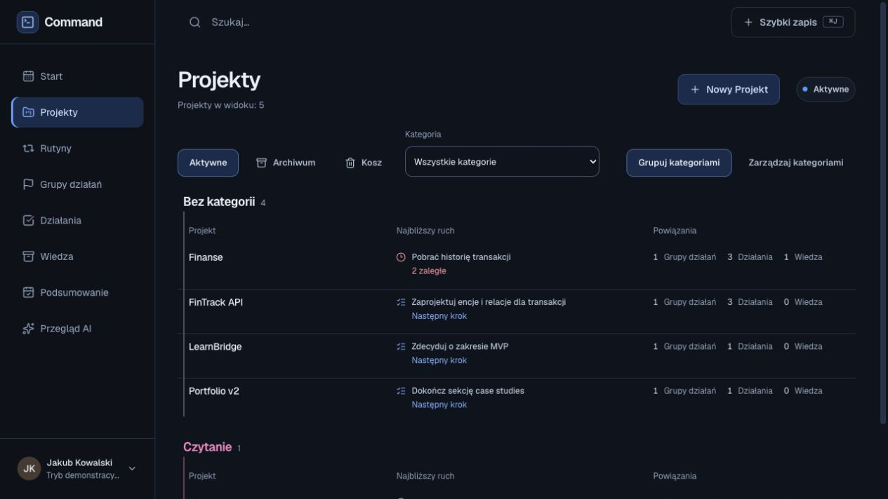
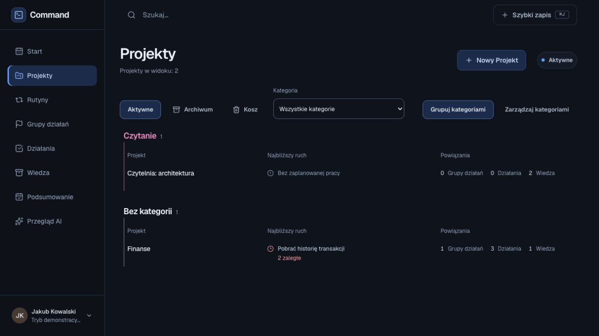

# Audyt UI/UX Command

**26 listopada 2026 · lokalna wersja robocza**

**53 ustalenia i 71 zrzutów** · 5 z priorytetem P1, 28 z P2 i 20 z P3.

Najpierw napraw utratę widoczności danych demo po odświeżeniu, nieskończone ładowanie brakującego Działania, mylące filtrowanie terminów i brak tytułów na mobilnych ekranach. Te problemy utrudniają orientację lub prowadzą do błędnych decyzji przy planowaniu.

## Zakres i sposób sprawdzenia

Sprawdziłem główne moduły, szczegóły rekordów, formularze, nawigację, wyszukiwanie, stany puste, komunikaty, wybrane interakcje klawiaturą oraz responsywność. Główny przebieg odbył się w przeglądarce Codex na osobnej lokalnej instancji demo. Użyłem widoków 1440 × 900, 1024 × 768, 768 × 1024, 390 × 844 i 320 × 740 CSS px. Reprodukcję odświeżenia powtórzyłem w osobnej sesji na desktopie ze stałym rozmiarem. Do sprawdzenia logowania użyłem osobnej, niezalogowanej instancji z konfiguracją konta prywatnego. Zastaną kartę z danymi użytkownika obejrzałem wyłącznie w trybie odczytu. Zrzuty przedstawiają demo lub ekran niezalogowany.

**Priorytety.** P1 oznacza problem, który blokuje ścieżkę, ukrywa dane albo istotnie wprowadza w błąd. P2 oznacza zauważalne utrudnienie, obejście lub problem dostępności. P3 oznacza lokalny problem czytelności, spójności lub tekstu. Przy ustaleniach opartych wyłącznie na źródle podaję to wprost.

## Przebieg i wynik

| Krok | Ścieżka | Wynik i dowody |
| --- | --- | --- |
| 1 | Logowanie, pomoc przy haśle, wejście bez linku do resetu | Formularz się renderuje. Konfiguracja prywatna kieruje odzyskiwanie dostępu do administratora. [Desktop](screenshots/52-logowanie-desktop.jpg) · [Pomoc](screenshots/53-logowanie-pomoc-desktop.jpg) · [Telefon](screenshots/54-logowanie-mobile.jpg) · [Wejście do resetu](screenshots/57-reset-hasla-przekierowanie.jpg) |
| 2 | Start i nawigacja | Widać pracę na dziś, zaległości i powrót do pracy po odwiedzeniu szczegółów. Na telefonie pasek nagłówka pokazuje samą markę. [Desktop](screenshots/01-start-desktop.jpg) · [Telefon](screenshots/30-start-mobile.jpg) · [Więcej](screenshots/31-wiecej-mobile.jpg) |
| 3 | Szybki zapis → Skrzynka → Biblioteka | Zapis i zamiana wpisu na notatkę działają. Wynik przetworzenia prowadzi do notatki, historii lub następnego wpisu. [Formularz](screenshots/27-szybki-zapis-desktop.jpg) · [Po zapisie](screenshots/28-szybki-zapis-wynik-desktop.jpg) · [Telefon](screenshots/47-szybki-zapis-mobile.jpg) · [Skrzynka](screenshots/19-skrzynka-desktop.jpg) · [Wybór operacji](screenshots/20-skrzynka-porzadkowanie-desktop.jpg) · [Notatka](screenshots/21-skrzynka-notatka-desktop.jpg) · [Skrzynka na telefonie](screenshots/33-skrzynka-mobile.jpg) · [Tablet](screenshots/63-skrzynka-tablet.jpg) |
| 4 | Wyszukiwanie globalne | Nowy wpis ze Skrzynki jest wyszukiwalny, strzałki zmieniają zaznaczenie. Wynik przetworzonego wpisu otwiera go obok niewłaściwej karty, a znikające z demo encje przestają się wyszukiwać. [Wpis](screenshots/18-szukaj-wpis-skrzynki-desktop.jpg) · [FinTrack](screenshots/29-szukaj-wyniki-desktop.jpg) · [Wpis przetworzony](screenshots/62-szukaj-przetworzony-wpis.jpg) |
| 5 | Działania, filtry, szczegóły, edycja, utworzenie, ukończenie i cofnięcie | Zapis testowy oraz cofnięcie ukończenia zadziałały. Plus i filtry są mniej czytelne na telefonie, a przypięcie i termin nakładają się znaczeniowo. [Lista](screenshots/02-dzialania-desktop.jpg) · [Szczegóły](screenshots/12-dzialanie-szczegoly-desktop.jpg) · [Edycja](screenshots/14-edycja-dzialania-desktop.jpg) · [Filtry](screenshots/15-dzialania-filtry-desktop.jpg) · [Tworzenie](screenshots/16-dodaj-dzialanie-desktop.jpg) · [Potwierdzenie](screenshots/17-dzialanie-zapis-desktop.jpg) · [Telefon](screenshots/34-dzialania-mobile.jpg) · [Szczegóły na telefonie](screenshots/39-dzialanie-szczegoly-mobile.jpg) · [320 px](screenshots/48-dzialania-320.jpg) · [Filtry 320 px](screenshots/49-filtry-320.jpg) |
| 6 | Projekty, kategorie, szczegóły i archiwizacja | Utworzenie projektu z dwiema kategoriami i archiwizacja projektu próbnego zadziałały. Przegląd zmienia zakres wraz z szerokością, a w archiwum brakuje wejścia do szczegółów z listy. [Lista](screenshots/03-projekty-desktop.jpg) · [Szczegóły](screenshots/06-projekt-szczegoly-desktop.jpg) · [1024 px](screenshots/64-projekt-1024.jpg) · [Formularz](screenshots/60-projekt-formularz.jpg) · [Dwie kategorie](screenshots/67-projekt-w-kategoriach.jpg) · [Pusty projekt](screenshots/68-projekt-pusty.jpg) · [Pusta karta grup](screenshots/69-projekt-pusta-zakladka-grup.jpg) · [Potwierdzenie](screenshots/70-projekt-archiwizacja.jpg) · [Archiwum](screenshots/71-projekt-w-archiwum.jpg) · [Lista na telefonie](screenshots/35-projekty-mobile.jpg) · [Szczegóły na telefonie](screenshots/36-projekt-mobile.jpg) |
| 7 | Grupy działań, filtry, szczegóły i tworzenie | Szczegóły pokazują działania i kryteria. Stan filtrów jest słabo widoczny na desktopie, a kilka pojęć wymaga doprecyzowania. [Lista](screenshots/04-grupy-desktop.jpg) · [Szczegóły](screenshots/05-grupa-szczegoly-desktop.jpg) · [Formularz](screenshots/61-grupa-formularz.jpg) · [Lista na telefonie](screenshots/37-grupy-mobile.jpg) · [Szczegóły na telefonie](screenshots/38-grupa-szczegoly-mobile.jpg) |
| 8 | Biblioteka, podgląd, szczegóły, książka i filtry | Podgląd daje dostęp do pełnego widoku. Typ książki na liście i w szczegółach jest opisany inaczej, a archiwum ukryto w filtrach. [Biblioteka](screenshots/07-wiedza-desktop.jpg) · [Podgląd](screenshots/22-wiedza-podglad-desktop.jpg) · [Szczegóły](screenshots/23-wiedza-szczegoly-desktop.jpg) · [Filtry](screenshots/66-wiedza-filtry-desktop.jpg) · [Telefon](screenshots/32-wiedza-mobile.jpg) · [Książka](screenshots/40-ksiazka-mobile.jpg) |
| 9 | Rutyny i edycja serii | Harmonogram i przypisanie są widoczne. Formularz edycji powtarza wprowadzenie i szablony tworzenia. [Desktop](screenshots/08-rutyny-desktop.jpg) · [Telefon](screenshots/41-rutyny-mobile.jpg) · [Edycja](screenshots/42-rutyna-edycja-mobile.jpg) |
| 10 | Podsumowanie, plan, historia | Pusta historia ma drogę powrotu. Plan pokazuje zaległe pozycje jako „Bez terminu”, a na małym ekranie trudno dotrzeć do końca listy dni. [Podsumowanie](screenshots/09-podsumowanie-desktop.jpg) · [Plan](screenshots/25-plan-desktop.jpg) · [Po wyborze grupy](screenshots/58-plan-wybrana-grupa-desktop.jpg) · [Bez terminu](screenshots/59-plan-bez-terminu-desktop.jpg) · [Historia](screenshots/26-historia-desktop.jpg) · [Telefon](screenshots/43-podsumowanie-mobile.jpg) · [Plan na telefonie](screenshots/44-plan-mobile.jpg) · [Agenda 320 px](screenshots/65-plan-agenda-320.jpg) |
| 11 | Przegląd AI i ustawienia | Symulacja wyświetla wynik i zakres. Jej okno potwierdzenia sugeruje zewnętrzną wysyłkę, a nawigacja rekomendacji wymaga dodatkowych kroków. [Przed analizą](screenshots/10-ai-desktop.jpg) · [Potwierdzenie](screenshots/11-ai-po-uruchomieniu-desktop.jpg) · [Wynik](screenshots/13-ai-wynik-desktop.jpg) · [Telefon](screenshots/45-ai-mobile.jpg) · [Ustawienia](screenshots/24-ustawienia-desktop.jpg) · [Ustawienia na telefonie](screenshots/46-ustawienia-mobile.jpg) |
| 12 | Odświeżenie, nieznana ścieżka i brakujący rekord | Odświeżenie usuwa przykładowe encje z widoków demo. Brakujące Działanie zostaje w stanie ładowania. Historia Focus pokazuje stan braku rekordu bez przycisku powrotu. [Przed](screenshots/50-demo-przed-odswiezeniem.jpg) · [Po](screenshots/51-demo-po-odswiezeniu.jpg) · [Brak Działania](screenshots/56-brak-dzialania-desktop.jpg) · [Brak sesji Focus](screenshots/55-historia-focus-brak-desktop.jpg) |

## Lista ustaleń

### Dane i nawigacja

#### UI-01 · P1 · Przykładowe dane demo znikają po odświeżeniu
W nowej sesji demo otwórz Projekty, poczekaj na pełną listę i odśwież stronę. Licznik spada z 5 do 2, a FinTrack API, LearnBridge i Portfolio v2 znikają przy tej samej szerokości. W głównej sesji po przeładowaniu widać też spadek z 5 aktywnych grup do 1 oraz brak pięciu przykładowych działań. Wyszukiwanie „FinTrack” zwraca wówczas jedynie wpis Wiedzy, którego opis zawiera tę frazę. Kod tworzy startowe encje pochodzące ze starszego modelu, po czym migracja po odczycie usuwa te encje z widoków aktywnych.

**Do poprawy.** Użyj w demo trwałych danych w aktualnym modelu. Pierwsze wejście i ponowne otwarcie muszą pokazywać te same rekordy i dawać te same wyniki wyszukiwania. [Przed](screenshots/50-demo-przed-odswiezeniem.jpg) · [Po](screenshots/51-demo-po-odswiezeniu.jpg) · [Wyszukiwanie](screenshots/29-szukaj-wyniki-desktop.jpg) · [Inicjalizacja i zapis](../../../apps/web/src/app/store.tsx#L218) · [Migracja](../../../apps/web/src/domain/goals.ts#L152)

#### UI-02 · P1 · Brakujące Działanie ładuje się bez końca w demo
Wpisz nieistniejący identyfikator pod `/actions/`. Po kolejnych odczytach ekran stale pokazuje „Ładowanie Działania…”. Zapytanie jest wyłączone w demo, a warunek renderowania nadal interpretuje jego stan oczekiwania jako trwające pobieranie. Ten scenariusz odcina użytkownika od jasnego wyjaśnienia i CTA do listy.

**Do poprawy.** Pokaż ładowanie wyłącznie podczas rzeczywistego odczytu. Rozróżnij brak rekordu, błąd odczytu i możliwość ponowienia. Dodaj powrót do Działań. [Zrzut](screenshots/56-brak-dzialania-desktop.jpg) · [Warunek zapytania](../../../apps/web/src/pages/ActionDetailPage.tsx#L39)

#### UI-03 · P1 · Mobilny nagłówek ukrywa nazwę aktualnego modułu
Na telefonie otwórz kolejno Działania, Projekty, Grupy działań, Wiedzę, Rutyny, Podsumowanie, AI i Ustawienia. Na górze każdego ekranu pojawia się „Command”. W CSS tytuł `h1` ma 1 × 1 px i jest przycięty, a część pozycji używa wspólnego aktywnego „Więcej”. Bez widocznego tytułu użytkownik może nie wiedzieć, gdzie trafił po otwarciu linku.

**Do poprawy.** Wyświetl nazwę modułu w nagłówku. Na poziomie szczegółów pokaż także jednoznaczną drogę do listy. [Grupy](screenshots/37-grupy-mobile.jpg) · [Podsumowanie](screenshots/43-podsumowanie-mobile.jpg) · [Ustawienia](screenshots/46-ustawienia-mobile.jpg) · [CSS](../../../apps/web/src/polish.css#L530)

#### UI-04 · P2 · Nieznany URL przekierowuje na Start bez wyjaśnienia
Otwórz nieznaną ścieżkę, np. `/audyt-nieznana-sciezka`. Aplikacja zastępuje URL adresem `/` i renderuje zwykły Start. Osoba z uszkodzonym linkiem nie dostaje informacji, dlaczego nie trafiła do wskazanego miejsca.

**Do poprawy.** Pokaż stan nieznanego adresu z powrotem na Start i wejściem do wyszukiwania. Zachowaj celowe przekierowania starych adresów. [Definicje tras](../../../apps/web/src/app/App.tsx#L83)

#### UI-05 · P2 · Błędy szczegółów mają niespójne drogi wyjścia
Projekt i Wiedza oferują powrót do właściwej listy. Brak sesji Focus pokazuje sam komunikat, a fallback Działania w kodzie prowadzi na Start. Komunikat grupy ma też błąd „Grupa […] nie jest dostępny”.

**Do poprawy.** Każdy brakujący rekord powinien wskazywać właściwy moduł lub zachowany kontekst nawigacji, a przy błędzie odczytu dawać możliwość ponowienia. [Brak sesji](screenshots/55-historia-focus-brak-desktop.jpg) · [Działanie](../../../apps/web/src/pages/ActionDetailPage.tsx#L46) · [Grupa](../../../apps/web/src/pages/GoalDetailPage.tsx#L98)

#### UI-06 · P2 · Pasek boczny na tablecie opiera się wyłącznie na ikonach
Przy 768 i 1024 px główna nawigacja mieści osiem ikon, ale nie pokazuje ich podpisów. Nazwy istnieją w drzewie dostępności. Osoba widząca musi rozpoznawać m.in. flagę, checkbox i gwiazdki, szczególnie przy pierwszym użyciu na tablecie dotykowym.

**Do poprawy.** Udostępnij rozwijany pasek z nazwami lub etykiety dostępne również dotykiem i klawiaturą. [768 px](screenshots/63-skrzynka-tablet.jpg) · [1024 px](screenshots/64-projekt-1024.jpg)

#### UI-07 · P2 · Skrzynka ma różną pozycję w nawigacji
Na desktopie Skrzynka znajduje się pod Wiedzą, na telefonie „Wiedza” i „Skrzynka” pojawiają się obok siebie w menu Więcej, a w Szybkim zapisie istnieje osobny link. Na desktopie licznik nowych wpisów widać dopiero wewnątrz Wiedzy. To utrudnia zbudowanie nawyku powrotu do tego samego miejsca.

**Do poprawy.** Zapewnij konsekwentny punkt wejścia do Skrzynki i licznik oczekujących wpisów tam, gdzie zaczyna się nawigacja. [Desktop](screenshots/19-skrzynka-desktop.jpg) · [Więcej](screenshots/31-wiecej-mobile.jpg) · [Szybki zapis](screenshots/27-szybki-zapis-desktop.jpg)

#### UI-08 · P2 · Powtarzalnej nawigacji nie można pominąć jednym skrótem
Drzewo dostępności zaczyna się od nawigacji i profilu, przed właściwą treścią. W kodzie powłoki nie ma linku „Przejdź do treści”. Użytkownik klawiatury przechodzi przez powtarzające się kontrolki lub musi użyć możliwości nawigacji po punktach orientacyjnych, jeśli ma je w swoim narzędziu.

**Do poprawy.** Pierwszy fokusowalny element powinien przenosić fokus na główną treść i być widoczny po naciśnięciu Tab. [Powłoka](../../../apps/web/src/components/AppShell.tsx#L249) · [Układ desktop](screenshots/01-start-desktop.jpg)

#### UI-09 · P3 · Skrót „⌘J” w nagłówku zakłada klawiaturę z klawiszem Command
Etykieta „Szybki zapis ⌘J” jest zapisana na stałe w widoku desktopowym. Na pozostałych platformach podpowiedź może nie odpowiadać klawiszom użytkownika. Sprawdzenie dotyczy etykiety w kodzie, bez testu Windows i Linux.

**Do poprawy.** Powiąż wyświetlany opis z obsługiwanym skrótem na danej platformie. [Nagłówek](../../../apps/web/src/components/AppShell.tsx#L276)

### Wyszukiwanie i Szybki zapis

#### UI-10 · P2 · Wynik przetworzonego wpisu otwiera kartę „Nowe”
Zapisz wpis ze Skrzynki jako notatkę, wyszukaj fragment jego treści i wybierz wynik oznaczony „Skrzynka”. Panel pokazuje oryginał oraz tekst „Wpis jest w widoku: Przetworzone”. Po lewej pozostaje karta „Nowe”. W panelu nie ma bezpośredniego działania do otwarcia wpisu we właściwej karcie ani przejścia do jego notatki.

**Do poprawy.** Otwórz kartę odpowiadającą statusowi wpisu, zaznacz pozycję i pokaż link do utworzonego wyniku, jeśli istnieje. [Zrzut](screenshots/62-szukaj-przetworzony-wpis.jpg) · [Budowanie adresu wyniku demo](../../../apps/web/src/data/localWorkspaceRepository.ts#L310)

#### UI-11 · P2 · Escape usuwa zapytanie i fokus podczas zamykania wyników
Wpisz frazę w globalnej wyszukiwarce i naciśnij Escape. Lista się zamyka, wpisana fraza znika, a pole traci fokus. Aby skorygować tekst, trzeba ponownie otworzyć pole i go wpisać.

**Do poprawy.** Pierwsze Escape zamyka podpowiedzi i zostawia frazę oraz fokus. Osobna kontrolka służy do czyszczenia. [Obsługa klawiszy](../../../apps/web/src/components/GlobalSearch.tsx#L72)

#### UI-12 · P2 · Dwa modele klawiatury w tej samej liście wyników
Wpisz „Audyt UI” po utworzeniu wpisu i działania. ArrowDown zmienia aktywną opcję przez `aria-activedescendant` i zachowuje fokus w polu. Tab przechodzi do „Wyczyść wyszukiwanie”, po czym kolejny Tab przenosi do pierwszej opcji wyniku, nawet gdy strzałką zaznaczono drugą. W efekcie opcja wizualnie zaznaczona i opcja z faktycznym fokusem mogą się rozjechać.

**Do poprawy.** Użyj jednego modelu comboboxa. Wybór klawiaturą powinien prowadzić do tej samej pozycji, którą interfejs wskazuje jako aktywną. [Kod listy opcji](../../../apps/web/src/components/GlobalSearch.tsx#L72)

#### UI-13 · P3 · Nazwa wyszukiwania pomija Skrzynkę, a wyniki mają puste separatory
Pole w drzewie dostępności wylicza Projekty, grupy, Działania i Wiedzę. Wyszukuje też nowe wpisy ze Skrzynki. Dla braku opisu pod tytułem renderuje „Skrzynka ·” albo „Działania ·”.

**Do poprawy.** Nazwij zakres zgodnie z działaniem i renderuj separator tylko z istniejącym opisem. [Wynik Skrzynki](screenshots/18-szukaj-wpis-skrzynki-desktop.jpg) · [Renderowanie](../../../apps/web/src/components/GlobalSearch.tsx#L72)

#### UI-14 · P2 · Potwierdzenie szybkiego zapisu konkuruje z następnym zapisem
Na `/capture` po zapisaniu tekstu pozostaje puste pole, nieaktywny „Zapisz”, zielone „Zapisano”, trzy akcje pod formularzem i osobny komunikat „Zapisano w Skrzynce”. „Otwórz” dubluje „Otwórz zapis”, a użytkownik musi zdecydować, czy pisać w widocznym polu, czy najpierw wybrać „Zapisz kolejną myśl”.

**Do poprawy.** Po zapisie pokaż jedno potwierdzenie z nazwą miejsca i drogą do wpisu. Kolejny zapis powinien mieć jeden jasny punkt startu. [Przed](screenshots/27-szybki-zapis-desktop.jpg) · [Po](screenshots/28-szybki-zapis-wynik-desktop.jpg)

#### UI-15 · P3 · Formularz odcina kontekst nawigacji przy wejściu ze Startu
„Zapisz myśl lub link” otwiera pełnoekranowy Szybki zapis. Znika zwykła nawigacja, a powrót odbywa się przez link marki „Command” albo historię przeglądarki. Użytkownik powtarzający tę czynność nie ma widocznego „Wróć do Startu”.

**Do poprawy.** Zachowaj uproszczony ekran, dodając czytelną kontrolkę powrotu. [Telefon](screenshots/47-szybki-zapis-mobile.jpg)

### Działania

#### UI-16 · P1 · „Na dziś” nie odróżnia przypięcia od terminu
Otwórz „Spisać stałe koszty”. Szczegóły i lista mówią „Na dziś”. W edycji „Termin” jest pusty, bo rekord został przypięty do Startu bez daty. W Projekcie ta sama pozycja jest uwzględniana jednocześnie w licznikach „Na dziś” i „Bez terminu”. Użytkownik może uznać, że zaplanował termin lub go utracił.

**Do poprawy.** Wyświetl „Przypięte do Startu” niezależnie od daty. W filtrach jasno określ, czy „Na dziś” oznacza termin, przypięcie czy ich sumę. [Lista](screenshots/02-dzialania-desktop.jpg) · [Szczegóły](screenshots/12-dzialanie-szczegoly-desktop.jpg) · [Pusty termin w edycji](screenshots/14-edycja-dzialania-desktop.jpg) · [Logika etykiety](../../../apps/web/src/domain/actionPresentation.ts#L29)

#### UI-17 · P2 · Skrót do ukończenia przypomina zwykłe pole wyboru
W otwartych działaniach kliknięcie okręgu przed tytułem od razu kończy Działanie i usuwa wiersz z widoku. Nazwa dostępna „Ukończ” jest właściwa. Wizualnie okrąg nie wyjaśnia skutku bez najechania lub znajomości wzorca. Cofnięcie działa przez czasowy komunikat.

**Do poprawy.** Na dotyku i klawiaturze zapewnij czytelną czynność ukończenia oraz trwałą ścieżkę przywrócenia z historii. [Lista desktop](screenshots/02-dzialania-desktop.jpg) · [Lista 320 px](screenshots/48-dzialania-320.jpg)

#### UI-18 · P2 · Po wyczyszczeniu nazwy brakuje widocznej informacji o wymaganiu
Otwórz Edytuj Działanie i zastąp nazwę samymi spacjami. „Zapisz zmiany” staje się nieaktywne. Pojawia się komunikat „Szkic zapisany na tym urządzeniu”, ale brak informacji przy nazwie, dlaczego właściwy zapis pozostaje niedostępny.

**Do poprawy.** Oznacz wymagane pole i po interakcji wyświetl lokalny komunikat „Podaj nazwę Działania”. Powiąż go programowo z polem. [Formularz](screenshots/14-edycja-dzialania-desktop.jpg) · [Implementacja](../../../apps/web/src/components/ActionEditDialog.tsx)

#### UI-19 · P2 · Kontekst Projektu ma uboższe i inaczej nazwane filtry Działań
W globalnych filtrach jest „Oczekujące” oraz „Testowanie”. Selektor w Projekcie nie pokazuje „Oczekujące”, a odpowiednik drugiego stanu nazywa „W trakcie testowania”. Na ekranie projektu trudniej odszukać pozycje w konkretnym statusie.

**Do poprawy.** Użyj tego samego słownika i zestawu statusów w widokach, które filtrują te same Działania. [Filtry globalne](screenshots/15-dzialania-filtry-desktop.jpg) · [Opcje projektu](../../../apps/web/src/pages/ProjectDetailPage.tsx#L168)

#### UI-20 · P2 · Przypisanie Działania działa inaczej przy tworzeniu i edycji
Formularz tworzenia kryje relację pod „Powiązania i opcje”. Wybór łączy grupy i Projekty na jednej liście, więc te same nazwy mogą wystąpić w dwóch znaczeniach. W edycji otrzymujesz osobne pola Projekt i Grupa działań. Osoba, która chce przypisać dokładny Projekt, musi odczytać różnicę między wariantami i domyślnym dziedziczeniem.

**Do poprawy.** Ujednolić wybór i wyjaśnić, skąd wynika Projekt po wybraniu grupy. Pokazać widoczny podgląd przypisania przed zapisem. [Tworzenie](screenshots/16-dodaj-dzialanie-desktop.jpg) · [Edycja](screenshots/14-edycja-dzialania-desktop.jpg)

#### UI-21 · P2 · Przycisk filtrów działań na telefonie zmienia położenie i traci tekst
Desktop pokazuje „Filtry” obok szybkich widoków i „Moich widoków”. Telefon używa pojedynczej ikony lejka nad dolnym paskiem, z dala od pozostałych filtrów. Przy 320 px przycisk i nawigacja pokrywają się wizualnie z obszarem listy.

**Do poprawy.** Umieść „Filtry” przy toolbarze listy albo pokaż podpis i licznik aktywnych filtrów przy przewidywalnym przycisku. Sprawdź widoczność ostatniego wiersza i jego fokusu. [390 px](screenshots/34-dzialania-mobile.jpg) · [320 px](screenshots/48-dzialania-320.jpg)

#### UI-22 · P3 · Kilka potwierdzeń pozostaje jednocześnie na kolejnych ekranach
Po utworzeniu Działania i cofnięciu jego ukończenia „Działanie dodane” i „Przywrócono stan sprzed zmiany” są nadal widoczne po przejściu do Skrzynki. Zajmują duży fragment widoku i mieszają wcześniejszy kontekst z nowym ekranem.

**Do poprawy.** Zastępuj komunikaty dotyczące tej samej operacji lub encji i kontroluj liczbę widocznych powiadomień, zachowując dostęp do ważnego Cofnij. [Stos po przejściu do Skrzynki](screenshots/19-skrzynka-desktop.jpg) · [Pojedyncze potwierdzenie](screenshots/17-dzialanie-zapis-desktop.jpg)

### Projekty i grupy działań

#### UI-23 · P2 · „Utwórz pierwszą grupę” prowadzi do pustej karty
Utwórz pusty Projekt i na jego przeglądzie wybierz „Przejdź do grup działań” w karcie „Utwórz pierwszą grupę działań”. Pojawia się „Brak bieżących grup” bez własnego CTA. Trzeba wrócić do ogólnego przycisku „Dodaj” i wybrać typ.

**Do poprawy.** Otwórz formularz grupy od razu, z wypełnionym Projektem. Dodaj tę samą akcję w pustej karcie grup. [Zachęta](screenshots/68-projekt-pusty.jpg) · [Stan po kliknięciu](screenshots/69-projekt-pusta-zakladka-grup.jpg)

#### UI-24 · P2 · Zawartość „Przeglądu” Projektu znika na mniejszym ekranie
Otwórz projekt Finanse w 1440 px, a następnie w 1024 px i na telefonie. Szeroki ekran pokazuje Działania, bieżące grupy i ostatnią Wiedzę. Pod tym samym aktywnym „Przegląd” w węższym wariancie zostaje tylko najbliższy ruch, mimo że przy 1024 px pozostaje dużo wolnego miejsca.

**Do poprawy.** Zachowaj treści przeglądu i ułóż je w jednej kolumnie albo pokaż ich skróty z czytelnymi linkami. [Szeroki widok](screenshots/06-projekt-szczegoly-desktop.jpg) · [1024 px](screenshots/64-projekt-1024.jpg) · [Telefon](screenshots/36-projekt-mobile.jpg)

#### UI-25 · P2 · Zarchiwizowanego Projektu nie można otworzyć z listy Archiwum
Po archiwizacji projektu próbnego kliknij „Archiwum”. Tytuł rekordu stał się zwykłym tekstem. Na liście można tylko przywrócić Projekt, choć szczegóły mają przygotowany stan projektu archiwalnego i jego zawartość jest zachowana.

**Do poprawy.** Udostępnij link do szczegółów w trybie odczytu bez zmiany stanu rekordu. Zostaw osobną akcję przywrócenia. [Archiwum](screenshots/71-projekt-w-archiwum.jpg) · [Widok projektu archiwalnego](../../../apps/web/src/pages/ProjectDetailPage.tsx#L343)

#### UI-26 · P3 · Liczba projektów i liczba wierszy po grupowaniu wyglądają na sprzeczne
Utwórz Projekt w kategoriach „Praca” i „Nauka”. Przy trzech unikatowych Projektach licznik mówi „Projekty w widoku: 3”, ale lista pokazuje cztery wiersze. Ten sam tytuł i akcja przywrócenia występują dwukrotnie także w Archiwum. Powielanie wynika z modelu grupowania. Brakuje wskazówki, że obie pozycje prowadzą do tego samego rekordu.

**Do poprawy.** Opisz licznik jako liczbę unikatowych Projektów i pokaż pozostałe kategorie w wierszu albo użyj pojedynczej pozycji przy grupowaniu. [Widok aktywny](screenshots/67-projekt-w-kategoriach.jpg) · [Archiwum](screenshots/71-projekt-w-archiwum.jpg)

#### UI-27 · P3 · „Propozycja kategorii” opisuje szablon Projektu
Domyślny formularz pokazuje „Propozycja kategorii: Standardowy. Możesz wybrać inny szablon.” „Standardowy” jest szablonem, a sekcja „Kategorie” zawiera osobne opcje. „Kategoria” występuje także jako typ Grupy działań w innym formularzu.

**Do poprawy.** Użyj „Sugerowany szablon” i jasno nazwij „Kategorie Projektu” oraz „Grupę kategorii” w ich własnym kontekście. [Projekt](screenshots/60-projekt-formularz.jpg) · [Grupa](screenshots/61-grupa-formularz.jpg)

#### UI-28 · P2 · Wybrany status Grupy działań jest wizualnie prawie niewidoczny
Na desktopie na liście grup „Aktywny” i sąsiednie nieaktywne opcje mają ten sam kolor tekstu, bez wyróżniającego obrysu i znacznika. Obliczone tło aktywnej opcji to rgb(12, 18, 30), taki sam kolor jak podłoże widoku. Stan istnieje w DOM jako aria-pressed i data-state.

**Do poprawy.** Dodaj widoczny wskaźnik wyboru. Sprawdź osobno stan aktywny, fokus i najechanie. [Zrzut](screenshots/04-grupy-desktop.jpg)

#### UI-29 · P2 · Grupa filtrów jest ogłoszona jako tablista z przyciskami
Na liście grup drzewo dostępności pokazuje tablist z elementami o roli button. Sprawdziłem ArrowRight na „Wstrzymany”. Fokus i wybór pozostały w tym samym miejscu. Niespójna semantyka zapowiada obsługę zakładek, której kontrolki nie realizują.

**Do poprawy.** Jeśli to filtry, nazwij je jako grupę przycisków ze stanem wciśnięcia. Jeśli to zakładki, zastosuj pary zakładka–panel i ich obsługę klawiaturą. [Kod filtrów](../../../apps/web/src/pages/GoalsPage.tsx#L41)

#### UI-30 · P3 · „Każdy typ grupy” i „Każdy typ” są trudne do rozróżnienia
Na desktopie dwa pola stoją obok siebie bez widocznych etykiet. Jedno filtruje Kategorię i Zadanie nadrzędne, drugie obszary typu Nauka i Utrzymanie. Nazwy dostępne rozróżniają je lepiej niż tekst widoczny na ekranie.

**Do poprawy.** Pokaż etykiety „Typ grupy” i „Rodzaj zadania”, także przy wybranej wartości domyślnej. [Zrzut](screenshots/04-grupy-desktop.jpg)

#### UI-31 · P3 · „Zaległe” wygląda jak status wyświetlonego następnego Działania
W wierszu grupy budżetu obok „Spisać stałe koszty” w kolumnie „Następne Działanie / sygnały” pojawia się „Zaległe”. W szczegółach zaległe są dwa inne Działania, a pokazane jako następne widnieje „Na dziś”. Odznaka bez liczby i podmiotu łatwo sugeruje zaległość konkretnego kroku.

**Do poprawy.** Wypisz osobno następny krok i stan grupy, np. „2 zaległe w grupie”. [Lista](screenshots/04-grupy-desktop.jpg) · [Szczegóły grupy](screenshots/05-grupa-szczegoly-desktop.jpg)

### Skrzynka, Biblioteka i Rutyny

#### UI-32 · P2 · Skrzynka dubluje wejścia i ukrywa porządkowanie seryjne przy dwóch wpisach
Kliknięcie tytułu nowego wpisu otwiera panel „Co chcesz z tym zrobić?” i rozwija „Uporządkuj” dla tego wiersza. Obie kontrolki zabierają miejsce w każdym wierszu, a na telefonie przycisk wymaga dodatkowego wiersza. „Uporządkuj 3 wpisy” znika po zejściu do dwóch, choć nadal są kolejne pozycje do przejścia.

**Do poprawy.** Zadbaj o jeden czytelny punkt rozpoczęcia na pozycję. Pokazuj akcję seryjną konsekwentnie, jeśli można przejść przez więcej niż jeden wpis. [Telefon](screenshots/33-skrzynka-mobile.jpg) · [Panel porządkowania](screenshots/20-skrzynka-porzadkowanie-desktop.jpg)

#### UI-33 · P3 · Formularz notatki powtarza treść i decyzję o typie
Wybierz „Zapisz notatkę” w Skrzynce. Następny ekran ponownie prosi o wybór Notatki, Materiału lub Decyzji i pokazuje tę samą treść w podglądzie oryginału oraz w edytowalnym polu. Na desktopie podstawowe CTA wypada przy dolnej krawędzi pierwszego widoku.

**Do poprawy.** Wykorzystaj dokonany wybór jako stan domyślny. Użyj krótkiego „Zmień typ” i zwijanego podglądu oryginału. [Formularz](screenshots/21-skrzynka-notatka-desktop.jpg)

#### UI-34 · P2 · Archiwum i Kosz Wiedzy są ukryte pod „Widoczność”
W Projektach i Grupach działań są to nazwane widoki. W Bibliotece trzeba przejść przez „Filtry”, „Widoczność”, wybrać wartość i zatwierdzić. Użytkownik, który właśnie zarchiwizował wpis, musi odgadnąć inną ścieżkę odzyskania.

**Do poprawy.** Ujednolić położenie archiwum i kosza lub po archiwizacji pokazać bezpośrednią akcję „Otwórz archiwum”. [Filtry Biblioteki](screenshots/66-wiedza-filtry-desktop.jpg) · [Projekty](screenshots/03-projekty-desktop.jpg)

#### UI-35 · P3 · Typ „Książka” zmienia się na „Materiał” w szczegółach
Otwórz „Designing Data-Intensive Applications” z Biblioteki. W wierszu występuje „Książka”, a pełny widok pokazuje odznakę „Materiał” mimo widocznego statusu czytania i sekcji notatek.

**Do poprawy.** Użyj etykiety „Książka” na obydwu ekranach. [Lista](screenshots/32-wiedza-mobile.jpg) · [Szczegóły](screenshots/40-ksiazka-mobile.jpg)

#### UI-36 · P3 · Szczegóły bez daty pokazują „Zaktualizowano —”
Wpis bez daty wyświetla pustą metadaną „Zaktualizowano —”. Przykładowy rezultat dodatkowo ma „zaktualizowano wczoraj” w swojej treści, więc obie informacje stoją obok siebie. Tekst „wczoraj” pochodzi z danych demo. Pusta etykieta dotyczy każdego rekordu bez obu dat.

**Do poprawy.** Pomiń wiersz z datą, gdy daty brak. W demo użyj rzeczywistego pola daty i usuń datę z treści przykładowej. [Rezultat](screenshots/23-wiedza-szczegoly-desktop.jpg) · [Książka](screenshots/40-ksiazka-mobile.jpg) · [Kod szczegółów](../../../apps/web/src/pages/KnowledgeDetailPage.tsx#L146)

#### UI-37 · P3 · Podgląd Biblioteki ma słabą wskazówkę wizualną
W desktopowym wierszu tytuł otwiera pełne szczegóły, ikona prostokąta otwiera podgląd, a wielokropek menu operacji. Przycisk podglądu ma nazwę dostępną, ale z samej ikony trudno przewidzieć skutek. Na telefonie ta kontrolka znika.

**Do poprawy.** Nazwij akcję „Podgląd”, np. przez etykietę pojawiającą się na fokusie i najechaniu, oraz utrzymaj przewidywalną kolejność akcji. [Desktop](screenshots/07-wiedza-desktop.jpg) · [Otwarte](screenshots/22-wiedza-podglad-desktop.jpg) · [Telefon](screenshots/32-wiedza-mobile.jpg)

#### UI-38 · P2 · Edycja Rutyny wygląda jak tworzenie od nowa
„Edytuj ustawienia” otwiera „Edytuj serię cykliczną” z instrukcją „Zbuduj rytm krok po kroku” i paskiem gotowych propozycji ponad nazwą. Przy 390 px trzeba przewijać propozycje poziomo, a aktualny harmonogram i dalsze pola pionowo. Przy zmianie dnia użytkownik najpierw przechodzi przez wprowadzenie i szablony.

**Do poprawy.** W edycji zacznij od aktualnej nazwy, rytmu i najbliższych wykonań. Schowaj szablony za świadomą akcją „Zmień na szablon”. [Edycja mobilna](screenshots/42-rutyna-edycja-mobile.jpg)

#### UI-39 · P3 · Karta Rutyny pokazuje skrót checklisty bez zaznaczenia
Kod wyświetla pełną liczbę punktów i pierwsze trzy pozycje bez podania, ile ukryto. Przy dłuższej liście nagłówek może sugerować, że pod spodem widać całość. Potwierdzone w kodzie. Przykładowa Rutyna miała dwa punkty.

**Do poprawy.** Dodaj „Pokaż pozostałe N” lub ogranicz licznik do widocznych pozycji i daj link do całości. [Kod karty](../../../apps/web/src/pages/RoutinesPage.tsx#L78) · [Karta demo](screenshots/41-rutyny-mobile.jpg)

#### UI-40 · P3 · Użytkownik widzi mieszane nazwy tego samego obiektu
Na liście występuje „Rutyna”, w edycji „seria cykliczna”, a w domyślnej propozycji „Opróżnij Inbox” zamiast „Opróżnij Skrzynkę”. Tekst „Rutyna może wspierać Grupa działań” utrudnia zrozumienie przypisania.

**Do poprawy.** Użyj w nagłówku i zapisie terminu „Rutyna” i ujednolić słownictwo dla listy, formularza i propozycji. [Lista](screenshots/08-rutyny-desktop.jpg) · [Edycja](screenshots/42-rutyna-edycja-mobile.jpg)

### Plan i podsumowanie tygodnia

#### UI-41 · P1 · Filtr „Bez terminu” pokazuje działania z zapisanym terminem
W Podsumowaniu przejdź do Planu następnego tygodnia, zaznacz grupę budżetu i wybierz „Bez terminu 3”. W wynikach są dwie zaległe pozycje z datami z sierpnia oraz jedna pozycja bez terminu. Nagłówki wyników same określają dwie pierwsze jako „Inny termin”. Filtr zalicza terminy spoza planowanego tygodnia do kategorii bez daty.

**Do poprawy.** Wróć do literalnego znaczenia „Bez terminu” i dodaj osobny filtr „Poza tym tygodniem” albo użyj jednej nazwy z osobnymi podliczeniami. [Odtworzenie](screenshots/59-plan-bez-terminu-desktop.jpg) · [Grupowanie agendy](../../../apps/web/src/components/WeeklyPlanPanel.tsx#L65)

#### UI-42 · P2 · Dwa różne zakresy dat stoją na ekranie Planu
W Podsumowaniu przełącz na „Plan” i wybierz „Następny”. Nagłówek pozostaje „23 lis–29 lis”, a karta planu pokazuje „30 lis–6 gru”. Brakuje objaśnienia roli zakresu w nagłówku. Na telefonie globalny zakres znika razem z tytułem modułu.

**Do poprawy.** Dostrój nagłówek do aktywnego tygodnia planu lub wyróżnij rolę obu zakresów i podaj ją słownie. [Desktop](screenshots/25-plan-desktop.jpg) · [Telefon](screenshots/44-plan-mobile.jpg)

#### UI-43 · P2 · Przycisk zapisania podsumowania pojawia się przy operacjach planu
W karcie „Plan” pozostaje sekcja „Zamknięcie tygodnia” i „Zapisz podsumowanie”, nawet gdy użytkownik wybiera grupy na kolejny tydzień. Terminy mają odrębną operację „Zapisz terminy”. Sekcje są daleko od siebie, a różnica między zapisaniem decyzji, dat i podsumowania jest niejasna przy pierwszej wizycie.

**Do poprawy.** Umieść akcję podsumowania w karcie Tydzień lub wyraźnie nazwij jej okres. Pokaż stan zapisanych zmian w Planie. [Plan](screenshots/58-plan-wybrana-grupa-desktop.jpg) · [Renderowanie zapisu](../../../apps/web/src/pages/ReviewPage.tsx#L403) · [Zapis terminów](../../../apps/web/src/components/WeeklyPlanPanel.tsx#L281)

#### UI-44 · P2 · Wybór dnia w planie wymaga długiego przewijania w bok
Przy szerokości 320 px pasek dni ma ok. 239 px widocznej szerokości przy 964 px treści. Widać „Wszystkie”, poniedziałek i początek wtorku. Niedziela i „Bez terminu” są na końcu. Pasek przewijania jest jedyną wyraźną wskazówką, że opcje ciągną się dalej.

**Do poprawy.** Użyj mobilnego selektora dnia albo zawijanych filtrów z widocznym wyborem. Utrzymaj dostęp klawiaturą i brak poziomego przewijania całej strony. [Widok 320 px](screenshots/65-plan-agenda-320.jpg)

#### UI-45 · P3 · Liczniki spraw i sygnałów mają różne zakresy bez jasnych etykiet
Na przykładzie początkowego stanu „Wymaga uwagi” liczy 6 sygnałów, sekcja pokazuje 3 kategorie, a rozwijane „Zobacz wszystkie sprawy (5)” liczy pozycje z pozostałych sugestii. W ten sposób słowo „wszystkie” odnosi się do części zestawu.

**Do poprawy.** Napisz „Zobacz pozostałe 5 sygnałów” lub pokaż osobno unikatowe pozycje i liczbę sygnałów. [Podsumowanie](screenshots/09-podsumowanie-desktop.jpg) · [Zakres licznika](../../../apps/web/src/pages/ReviewPage.tsx#L305)

#### UI-46 · P3 · W historii archiwalnej widoczna jest etykieta „Na żywo”
Otwórz kartę Historia przy pustej liście. Nad sekcją archiwalną widnieje „Na żywo”, choć treścią karty są zapisane podsumowania. Status pochodzi ze stanu bieżącego tygodnia.

**Do poprawy.** Wiąż „Na żywo” z właściwą kartą Tydzień i opisuj historię jako zapisane podsumowania. [Historia](screenshots/26-historia-desktop.jpg) · [Renderowanie statusu](../../../apps/web/src/pages/ReviewPage.tsx#L249)

### AI, konto i czytelność

#### UI-47 · P2 · Symulacja AI ostrzega o wysyłce do zewnętrznego dostawcy
W demo obok pustej analizy widnieje „Symulacja”. Po kliknięciu „Przeanalizuj moje grupy działań” pojawia się tekst „Do skonfigurowanego dostawcy AI zostaną wysłane…”. Analiza używa lokalnych danych demonstracyjnych i lokalnego generatora. Rozbieżność utrudnia ocenę, co zostanie wysłane.

**Do poprawy.** W trybie symulacji opisz lokalny przebieg. W trybie zdalnym pokaż zakres danych i nazwę skonfigurowanego dostawcy w dialogu. [Ostrzeżenie](screenshots/11-ai-po-uruchomieniu-desktop.jpg) · [Wynik symulacji](screenshots/13-ai-wynik-desktop.jpg) · [Wykonanie demo](../../../apps/web/src/data/localWorkspaceRepository.ts#L330)

#### UI-48 · P2 · Rekomendacja „Otwórz grupę” nie daje bezpośredniego linku
Po uruchomieniu symulacji rekomendacja dla budżetu każe otworzyć grupę i zweryfikować termin oraz otwarte Działania. Nagłówek jest zwykłym tekstem, a widoczny kolejny krok nie zawiera przycisku do grupy. Kontekstu trzeba szukać w rozwijanych sekcjach albo poza tym ekranem.

**Do poprawy.** Dodaj na karcie bezpośredni link „Otwórz grupę” lub „Pokaż działania”, zależnie od rekomendacji. [Wynik AI](screenshots/13-ai-wynik-desktop.jpg)

#### UI-49 · P2 · W prywatnym trybie logowania odzyskanie hasła kończy się instrukcją
„Nie pamiętam hasła” rozwija wskazówkę o „Authentication → Users” i link do panelu Supabase. Osoba bez dostępu administracyjnego dostaje ogólną prośbę o kontakt z osobą, która dała jej dostęp. Bezpośrednie wejście na /reset-password wraca do logowania w tej konfiguracji. To obserwacja dotycząca konfiguracji prywatnej.

**Do poprawy.** Wskaż konkretny kontakt lub sposób zwrócenia się o odzyskanie dostępu i pokaż komunikat po wejściu niedziałającym linkiem. Jeśli prywatne wdrożenie ma dopuszczać samodzielny reset, skonfiguruj go niezależnie od publicznej rejestracji. [Pomoc](screenshots/53-logowanie-pomoc-desktop.jpg) · [Po wejściu do resetu](screenshots/57-reset-hasla-przekierowanie.jpg) · [Warunek resetu](../../../apps/web/src/auth/AuthGate.tsx#L15)

#### UI-50 · P3 · Na mobilnym logowaniu opis produktu wypycha formularz w dół
Przy 390 px pierwsze pola pojawiają się dopiero po marce, dużym haśle i akapicie o produkcie. Na ekranie skierowanym do powracającej osoby duża część pierwszego widoku opisuje produkt. Tekst logowania nadal nazywa Grupy działań „Celami”.

**Do poprawy.** Pokaż formularz wyżej, skróć wprowadzenie w powrotnej ścieżce i ujednolić nazwy modułów. [Telefon](screenshots/54-logowanie-mobile.jpg) · [Desktop](screenshots/52-logowanie-desktop.jpg)

#### UI-51 · P3 · Komunikaty w demo sugerują logowanie i synchronizację
Ustawienia podają „Przypomnienia są dostępne po zalogowaniu do konta”, mimo że aplikacja pokazuje w demo profil użytkownika. Brakuje jasnej informacji, że ograniczenie dotyczy trybu demonstracyjnego. Profil desktopowy łączy „Zsynchronizowano” z „Dane tylko w tej przeglądarce”.

**Do poprawy.** Opisz dostępność przypomnień wprost dla trybu demo. W profilu użyj np. „Zapisano na tym urządzeniu”. [Ustawienia](screenshots/24-ustawienia-desktop.jpg) · [Status profilu](../../../apps/web/src/components/AppShell.tsx#L260)

#### UI-52 · P3 · Niespójna polszczyzna utrudnia skanowanie komunikatów
W Podsumowaniu jest „Ustal następny krok dla jednego grupy”, w analizie „Otwórz Grupa działań”, a obok pojedynczej pozycji na liście „1 Grupa działań”. Nazwy modułów są często pisane wielką literą także w środku zdania.

**Do poprawy.** Popraw odmianę i liczbę w szablonach tekstów. Przy wspólnych słownikach dodaj przypadki odmiany dla 0, 1, 2, 5 i 12. [Podsumowanie](screenshots/09-podsumowanie-desktop.jpg) · [AI](screenshots/13-ai-wynik-desktop.jpg) · [Grupy](screenshots/37-grupy-mobile.jpg)

#### UI-53 · P3 · Kluczowe metadane w ciemnym motywie są drobne
Na desktopie terminy, typy i opisy są często renderowane jako tekst 12 px, a na telefonie dodatkowe opisy w Bibliotece ucinają się z wielokropkiem. Dla sprawdzonych próbek tekstu na jednolitym tle kontrast wynosił co najmniej 7,9:1. Problem dotyczy rozmiaru, hierarchii i utraconej po skróceniu informacji.

**Do poprawy.** Powiększ metadane potrzebne do decyzji albo pozwól im się zawijać przy wąskiej szerokości. Zachowaj kompaktowe rozmiary dla informacji pobocznej. [Biblioteka na telefonie](screenshots/32-wiedza-mobile.jpg) · [Działania](screenshots/02-dzialania-desktop.jpg)

## Kolejność napraw i warunki odbioru

1. **Stabilność danych i błędne adresy.** Nowa sesja demo, odświeżenie i ponowne wyszukanie pokazują te same encje. Uszkodzone odnośniki prowadzą do zrozumiałego komunikatu z drogą powrotu. UI-01, UI-02, UI-04, UI-05.
2. **Terminologia planowania i mobilna orientacja.** Przypięcie i data są rozróżnialne. Widok „Bez terminu” pokazuje wyłącznie rekordy bez dat. Przy 320 i 390 px użytkownik zawsze odczyta tytuł modułu oraz znajdzie filtry i akcję powrotu. UI-03, UI-16, UI-21, UI-41, UI-42, UI-44.
3. **Dostępność i odzyskiwanie kontekstu.** Wyszukiwarka oraz filtry mają spójny model klawiatury. Użytkownik otwiera trafiony wpis we właściwej karcie i podejrzy zarchiwizowany Projekt. UI-08, UI-10–UI-12, UI-25, UI-28, UI-29.
4. **Krótsze ścieżki i jednoznaczne komunikaty.** Jeden jasny wynik Szybkiego zapisu, prosty dostęp do utworzenia grupy, adekwatna treść potwierdzenia AI i konkretne teksty pomocy przy haśle. UI-14, UI-23, UI-47–UI-52.

## Granice weryfikacji

- Operacje zapisu wykonano w demo. Sprawdzono utworzenie Działania, ukończenie i cofnięcie, utworzenie Projektu i archiwizację, Szybki zapis, zapis wpisu jako notatki, filtrowanie oraz scenariusz symulacji AI. Przegląd ustawień i formularzy tworzenia grupy oraz edycji Rutyny zakończył się przed zapisem tych formularzy.
- Rejestracja, uwierzytelnienie prawdziwymi danymi, e-mail odzyskiwania hasła, powiadomienia, eksport pliku i produkcyjne operacje zdalne nie były testowane end-to-end. Widok resetu sprawdzono bez kodu odzyskiwania, na konfiguracji z wyłączoną publiczną rejestracją.
- W demo sprawdzono komunikat dla brakującej sesji Focus. Renderowanie istniejącego historycznego rekordu i zachowanie starszych aliasów przejrzano w kodzie.
- Widoki mobilne emulowano w przeglądarce. Wyniki nie obejmują rzeczywistej klawiatury ekranowej, iOS Safari, Androida, offline/PWA, pełnego przebiegu z czytnikiem ekranu ani wyczerpującego pomiaru kontrastu i symulacji 200–400% powiększenia.
- Audyt dotyczy lokalnego drzewa roboczego, które zmieniało się podczas sesji. Vite odnotował przeładowania komponentów tworzenia, filtrów i Biblioteki. Zrzuty dokumentują stan w chwili wykonania. Na przykład wcześniejsze zrzuty Biblioteki pokazują szybkie widoki, a późniejsze pokazują toolbar z polem wyszukiwania i przyciskiem filtrów.
- Zrzuty pokazują stan z bieżącego audytu i mogą zawierać syntetyczne rekordy oznaczone „Audyt UI”. Raport obejmuje ustalenia z tego przebiegu. Kod aplikacji nie był edytowany.

## Poprawki z 27 listopada 2026

| Ustalenia | Zmiana w aplikacji |
| --- | --- |
| UI-01, UI-02, UI-04–UI-09 | Dane demo pozostają dostępne po odświeżeniu. Brakujący rekord i nieznany adres mają własne komunikaty z drogą powrotu. Skrzynka ma stałe wejście z licznikiem, menu tabletowe ma etykiety, a klawiaturą można przejść od razu do treści. |
| UI-03 | Zachowano wspólny mobilny górny pasek z marką Command zgodnie z decyzją użytkownika. |
| UI-10–UI-15 | Wyszukiwanie zachowuje frazę po Escape i otwiera Skrzynkę we właściwym widoku. Szybki zapis pokazuje jedno potwierdzenie z linkiem do wpisu, opcją kolejnego zapisu i cofnięcia. |
| UI-16–UI-22 | Lista rozróżnia termin i przypięcie do Startu. Ujednolicono filtry statusu i wybór powiązań, oznaczono wymagany tytuł i ograniczono powielanie potwierdzeń. |
| UI-23–UI-31 | Z Przeglądu można utworzyć pierwszą grupę od razu. Na małym ekranie widać kontekst Projektu. Archiwum pozwala otworzyć Projekt i osobno go przywrócić. Filtry grup pokazują aktywny wybór. |
| UI-32–UI-40 | Tytuł wpisu otwiera porządkowanie, a oryginał w formularzu można rozwinąć. Biblioteka ma widoczne Archiwum, Kosz i Podgląd. Szczegóły książki zachowują jej typ. Edycja Rutyny pokazuje aktualne ustawienia przed szablonami. |
| UI-41–UI-46 | W Planie są osobne filtry „Bez terminu” i „Poza tym tygodniem”, a na telefonie dzień wybiera się z listy. Zapis podsumowania jest w karcie Tydzień. |
| UI-47–UI-53 | Demo AI opisuje lokalną symulację, rekomendacje prowadzą do grup, a formularz logowania jest krótszy. Poprawiono opisy demo, odmianę liczników i zawijanie metadanych. Samodzielny reset hasła można skonfigurować niezależnie od rejestracji. |

W przeglądarce sprawdzono odświeżenie danych demo, wyszukiwanie klawiaturą, brakujący rekord, przejście z zapisu do Skrzynki, podgląd książki, otwarcie i przywrócenie Projektu z Archiwum oraz mobilną agendę przy 320 px. Wysyłka e-maili wymaga środowiska Supabase z aktywną konfiguracją odzyskiwania hasła. [Konfiguracja wdrożenia](../../deployment/vercel.md)
