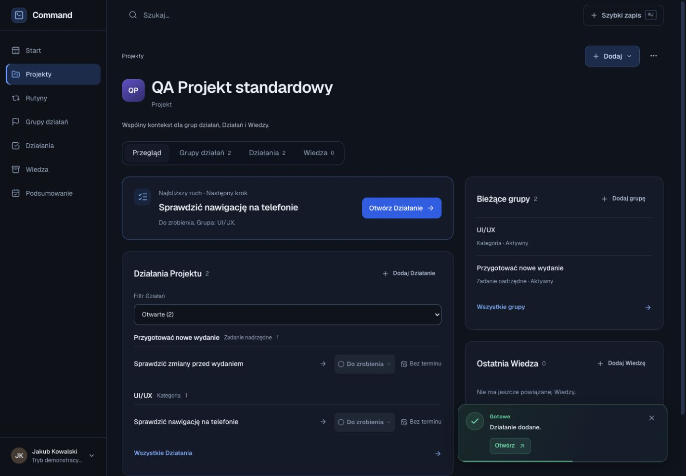

# Grupy Działań — drugie wydanie, 14 listopada 2026

Status: implementacja lokalna ukończona; migracje i przegląd AI wdrożone do
podłączonego Supabase Command. Frontend nie został opublikowany na hostingu.

## Zachowanie

Dotychczasowe Cele zastępuje wspólna lista **Grupy działań**. Nowa grupa
domyślnie jest **Kategorią**, np. UI/UX albo Wydajność. Wystarcza nazwa;
opis i pierwsze Działanie są opcjonalne. Kategorie pozostają otwarte na kolejne
Działania, bez kryteriów sukcesu, daty docelowej i ukończenia całej grupy.

**Zadanie nadrzędne** może mieć opis rezultatu, kryteria, datę i Działania.
Po wykonaniu ostatniego kroku pojawia się propozycja zamknięcia; ukończenie
wymaga osobnego potwierdzenia. Nie zamykamy grup automatycznie.

W Przeglądzie i pełnej liście Działań Projektu widać nagłówki grup z odmianą
i liczbą kroków. Działania bez przypisania są w sekcji „Bez grupy”. Edytor
Działania pozwala zmienić grupę w obrębie tego samego Projektu, zachowując ID,
opis, checklistę, historię i relacje. Wskazanie „następne” jest wtedy usuwane.

Tworzenie, triage, Rutyny, Wiedza, Start, plan tygodnia, przegląd AI oraz
eksport kontekstu używają nowego języka. Kategorie nie dostają ostrzeżeń o
braku rezultatu, kryteriów, następnego kroku lub nadmiarze Działań. Eksport
JSON dodaje opcjonalne `groupType`, zachowując dotychczasowy format.

## Zachowanie danych

Identyfikatory `Goal`, tabela `goals`, klucze `goalId` i adresy `/goals`
pozostają. Addytywna kolumna `group_type` domyślnie oznacza `task`; starszy
snapshot bez `groupType` również jest zadaniem. Szkice zachowują poprzedni typ,
wartości i klucze idempotencji. Nie zgadujemy kategorii na podstawie tytułu.

Konwersja zadania w kategorię jest blokowana, gdy rekord ma kryteria,
datę docelową, historię rezultatów/dowodów lub nie jest aktywny i widoczny.
Komunikat wyjaśnia przyczynę; dane nie są czyszczone dla odblokowania konwersji.
Guardy w bazie pilnują też zgodności Projektu i Workspace'u oraz serializują
tworzenie kryterium z konwersją grupy. Decyzja: [ADR 0010](../../adr/0010-action-groups.md).

Przed migracją i po niej porównano liczniki i sumy MD5 pełnych rekordów,
wyłączając jedynie dodaną kolumnę `group_type`. Wszystkie sumy są identyczne:

| Rekordy | Liczba | Suma przed i po |
| --- | ---: | --- |
| Dotychczasowe Cele | 14 | `2a9712b4a6ac19707f36b2dac39eaf05` |
| Działania | 135 | `4404d606acfbc602ce9db4cd55d4c84c` |
| Kryteria | 1 | `8d003ab6860a53430dc504a369405c6d` |
| Powiązania Wiedzy | 10 | `1fcddcbacd023440d280122ccd21ae5e` |
| Wpisy postępu | 8 | `8405a4a94402db15113fa7c11b8aa44c` |
| Szablony Rutyn | 4 | `266c6027efec47b008694f93c61e957a` |

Wszystkie 14 istniejących rekordów ma `group_type = task`; żaden nie został
automatycznie przemianowany ani przeniesiony.

## Wdrożenie backendu

`pnpm supabase:plan` wskazało dokładnie dwie oczekujące migracje. Zastosowano
je poleceniem `pnpm supabase:deploy`, zachowując wersje w historii:

1. `20261103200435_creation_triage_goal_options.sql` — zależność wspólnego triage.
2. `20261114114912_action_groups.sql` — odmiany grup, RPC i odczyt kontekstu.

Historia zdalna potwierdza obie wersje i obecność `create_action_group`.
CLI zatrzymało się po komunikatach zastosowania migracji i zostało przerwane
po potwierdzeniu commitów w bazie. Kolejne `pnpm supabase:plan` zakończyło się
poprawnie z `upToDate: true` i pustą listą migracji.
Próba pod rolą `authenticated` utworzyła kategorię bez rezultatu, sprawdziła
powiązanie pierwszego Działania, ukończenie go bez zamknięcia kategorii i dodanie
kolejnego. Całą próbę wycofano przez `ROLLBACK`; nie pozostały rekordy testowe.
Typy TypeScript wygenerowano z wdrożonego schematu.

`ai-goal-review` wdrożono jako wersję 19, z promptem 6 i zachowanym
`verify_jwt = true`. Względem wersji 18 zmieniły się tylko plik promptu i
minimalna wersja cache w entrypoincie; pozostałe zależności są identyczne.
Nie uruchamiano płatnego generowania odpowiedzi AI.

Doradca bezpieczeństwa nie zgłosił nowych problemów. Zniknęło ostrzeżenie
`search_path` dla zmienianego `get_workspace_core`. Pozostałe wcześniejsze
uwagi obejmują [sześć innych funkcji bez stałego search_path](https://supabase.com/docs/guides/database/database-linter?lint=0011_function_search_path_mutable),
[dwie prywatne tabele z RLS bez polityk](https://supabase.com/docs/guides/database/database-linter?lint=0008_rls_enabled_no_policy)
i [wyłączoną ochronę przed wyciekłymi hasłami](https://supabase.com/docs/guides/auth/password-security#password-strength-and-leaked-password-protection).
Te ustawienia nie były zmieniane w tym wydaniu.

## Weryfikacja

- `pnpm lint` i `pnpm typecheck` — poprawne.
- `pnpm test` — 85 plików, 649 testów, wszystkie poprawne.
- `VITE_DATA_BACKEND=demo pnpm build` — poprawnie, wraz z PWA.
- `git diff --check` — bez błędów.

Testy obejmują zmianę istniejącego schematu z już powiązanymi rekordami,
pełną równość danych po migracji, RLS między Workspace'ami, idempotencję,
zakazaną konwersję, jawne ukończenie zadania oraz przełożenie Działania.

Odbiór przeglądarkowy wykonano w osobnym lokalnym demo: utworzenie kategorii
UI/UX i zadania nadrzędnego w Projekcie, wykonanie kroku i dodanie kolejnego
w kategorii, osobne potwierdzenie ukończenia zadania oraz wznowienie starego
szkicu. Sprawdzono widok Projektu i grupy przy 1440 px oraz kategorię przy
390 i 320 px. Przy 320 px szerokość dokumentu wynosiła 305 px; brak
poziomego przewijania. Nie testowano fizycznego telefonu z klawiaturą systemową.

[Kategoria desktop](./category-desktop.jpg), [kategoria 390 px](./category-mobile.jpg),
[kategoria 320 px](./category-320.jpg).

## Publikacja i wycofanie

Backend jest gotowy dla nowego klienta. Publikacja frontendu pozostaje osobnym
krokiem; w tym zadaniu nie tworzono commita, nie wykonywano push ani deploymentu
całego drzewa roboczego. Po utworzeniu kategorii używać klienta rozumiejącego
`groupType`. W razie problemu wstrzymać tworzenie kategorii i poprawić klienta;
nie usuwać kolumn ani powiązanych danych, aby wycofać wydanie.
