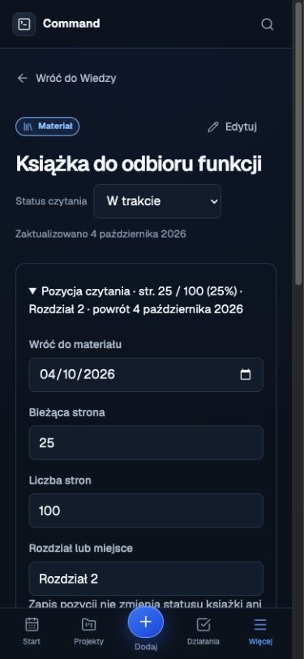
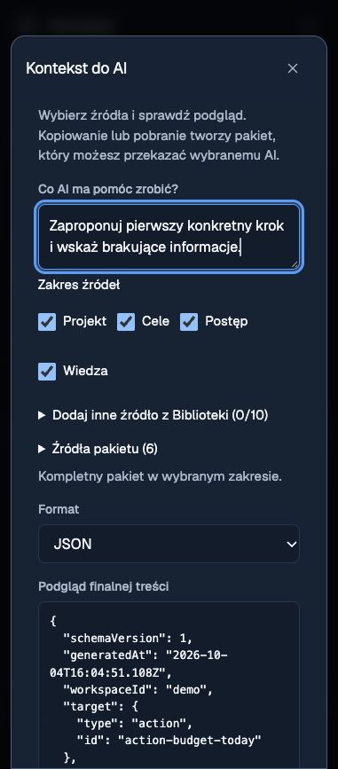
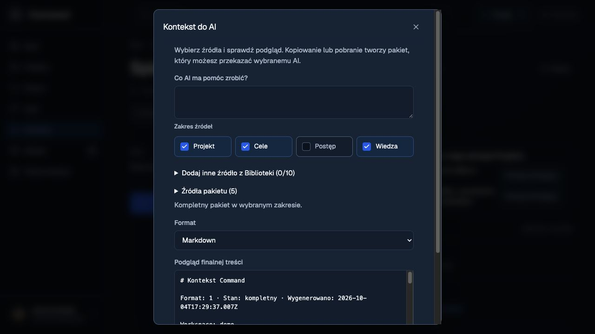
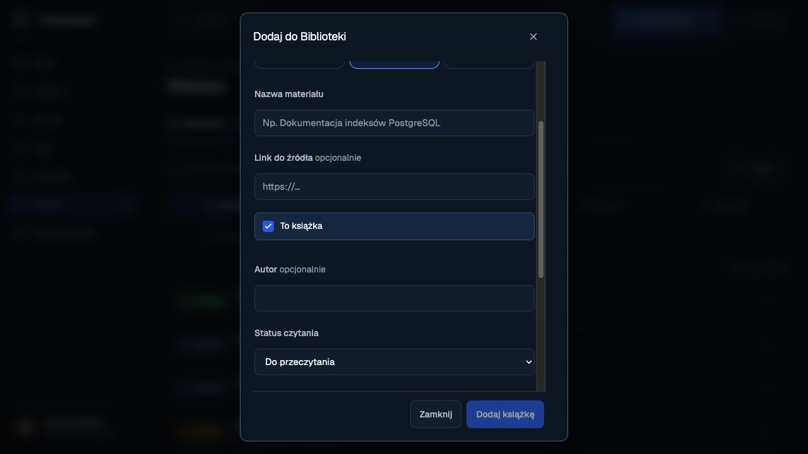
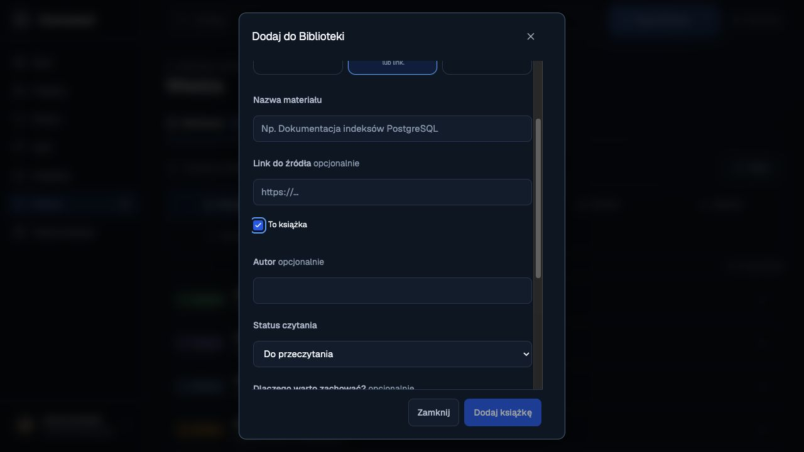
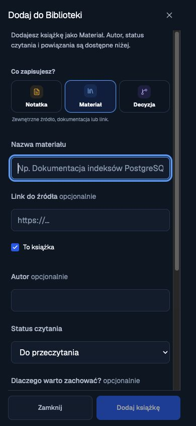

# Realizacja poprawek Startu i rozwoju Wiedzy

Data: 4 października 2026. Kod został zaimplementowany i sprawdzony lokalnie. Siedem migracji jest przygotowanych; zdalne wdrożenie oczekuje na wybór środowiska. Aplikacja na hostingu nie została opublikowana.

Realizacja obejmuje pięć poprawek pierwszego wydania oraz podpowiedzi Wiedzy, eksport kontekstu AI, ulubione widoki Działań i postęp czytania. Funkcje warunkowe — capture offline, Share Target i powtórki — pozostają poza realizacją do czasu wyboru ich zakresu i platformy.

## Zaimplementowane funkcje

| Obszar | Wynik |
| --- | --- |
| Metryki tygodnia | Start i Podsumowanie korzystają ze wspólnego selektora oraz granic tygodnia w strefie Workspace. Supabase używa pełnego agregatu. Brak pasującego agregatu pokazuje brak aktualnych metryk i ponowienie odczytu. |
| Aktualizacja metryk | Odczyty po zapisach są grupowane; koordynator odrzuca starsze odpowiedzi. Zmiana tygodnia i powrót do karty aktualizują okres. |
| Rekomendacje | Blokady z przyszłym terminem powrotu pozostają spokojne. Blokady wymagające powrotu dzisiaj lub wcześniej mają priorytet. Następnie wybierane są wykonalne Działania na dziś, z przypięciem i priorytetami tygodnia. |
| Plan tygodnia | Statusy i daty mają polskie etykiety. Odczyt aktualnej migawki nie zależy od odwiedzenia historii. Błąd odczytu jest widoczny i można go ponowić. |
| Stara analiza AI | Start pokazuje datę, przyczynę nieaktualności i odnośnik do analizy. Długi stary wynik nie dominuje nad planem dnia. |
| Czytelnia | Szczegół Projektu udostępnia przycisk wyboru szablonu, korzystający z istniejącego edytora. |
| Podpowiedzi Wiedzy | Adres jest porównywany konserwatywnie, z zachowaniem ścieżki, parametrów i fragmentu. Sugestie Projektu uwzględniają relacje do Celów, Działań, cykli i źródeł. Można powiązać istniejący materiał i cofnąć relację. Skrzynka może atomowo wskazać istniejący materiał, zachowując oryginalny capture. |
| Kontekst AI | Projekt, Cel i Działanie mają panel intencji, wyboru źródeł i podglądu Markdown lub JSON. Dostępne są kopiowanie, pobranie i odświeżenie. Pakiet zachowuje pochodzenie danych, główny obiekt oraz jawne ograniczenia: 40 000 znaków treści, 2000 znaków intencji i 256 KiB. |
| Ulubione widoki | Można zapisać do pięciu nazwanych filtrów Działań, odtworzyć je, zmienić nazwę i usunąć z cofnięciem. „Na dziś” odnosi się zawsze do aktualnego dnia. Widoki Supabase są prywatne dla użytkownika i Workspace. |
| Czytanie i powroty | Materiały i Notatki mają termin powrotu. Książki dodatkowo przechowują bieżącą stronę, liczbę stron i opis miejsca. Zapis nie kończy automatycznie książki ani Celu; można go cofnąć. Start prowadzi do kolejki „Do powrotu”, filtrowanej przed paginacją. |

Nowe reguły mają adaptery demo i Supabase. Zapisy z wersjami chronią przed nadpisaniem nowszej zmiany, a testy SQL sprawdzają izolację Workspace i właściciela ulubionych widoków. Wyszukiwanie duplikatów używa indeksu skrótu URL oraz pełnego porównania adresu, dzięki czemu długie adresy nie przekraczają limitu klucza indeksu.

## Kontrole lokalne

| Kontrola | Wynik |
| --- | --- |
| `pnpm lint` | Przeszła; obejmuje aplikację i pakiet kontekstu AI. |
| `pnpm typecheck` | Przeszła; obejmuje aplikację i osobny kontrakt `packages/ai-context`. |
| `pnpm test` | 75 plików, 522 testy przeszły. |
| `pnpm test:coverage` | 522 testy przeszły; wszystkie istniejące progi spełnione. |
| Pokrycie | Statements 71,75%; branches 67,67%; functions 63,49%; lines 82,72%. |
| Migracje w PGlite | 35 testów przeszło, w tym duplikaty URL, transakcja Skrzynki, limity i wersje widoków, pozycja książki oraz ograniczenia kontekstu AI. |
| `VITE_DATA_BACKEND=demo pnpm build` | Build oraz generowanie PWA przeszły. Pozostaje ostrzeżenie Vite o dużym chunku. |
| `pnpm performance:report` | Raport wygenerowany: entry JS 162 582 B gzip, entry CSS 50 719 B gzip, największy lazy route 54 775 B gzip. |
| `git diff --check` | Bez błędów formatowania zmian. |

Pełny przebieg z nieograniczoną liczbą procesów przekraczał czas oczekiwania w części testów ładowania tras. Te same testy przeszły osobno, a cały zestaw przeszedł z dwoma procesami. Domyślne `pnpm test` korzysta teraz z dwóch procesów; coverage zachowuje istniejący jeden proces. Nie zmniejszono progów pokrycia ani wymagań testów.

Raport wydajności porównuje build ze starszym zapisanym baseline. Jego różnica nie jest pomiarem kosztu wyłącznie tej realizacji. Nie przeprowadzono pomiarów Core Web Vitals ani pełnego profilu wydajności na telefonie.

## Odbiór przeglądarkowy

Testy mutujące wykonano w osobnym demo pod `http://127.0.0.1:5174/`. Potwierdzono zapis i odtworzenie widoku po reloadzie, usunięcie i cofnięcie, wybór Czytelni, powiązanie i cofnięcie materiału, wybór źródeł AI oraz zapis książki na stronie 25 z 100, z terminem powrotu. Start wskazał jeden materiał do powrotu, a otwarta kolejka pokazała właściwą książkę.

Sprawdzono brak poziomego przepełnienia przy szerokościach 360 px dla Wiedzy, 390 px dla formularza książki, 768 px dla szczegółu Działania oraz w wąskim podglądzie panelu AI. Te próby nie zastępują odbioru na rzeczywistym telefonie ani sprawdzenia każdego ekranu przy każdej szerokości.

Test komponentu potwierdził identyczność skopiowanej treści i podglądu, stabilność daty pakietu oraz wykluczenie pojedynczego źródła. Przeglądarka pokazała potwierdzenie kopiowania. Próba odczytania pobranego pliku przez automatyzację przeglądarki przekroczyła czas oczekiwania; zgodność rzeczywiście pobranego pliku pozostaje do odbioru ręcznego.

W otwartej aplikacji Supabase pod `http://localhost:5173/` wykonano odczyt bez zapisów testowych: Start pokazał 5 ukończonych Działań dla bieżącego tygodnia. Potwierdzono także, że wskazana blokada ma termin powrotu 30 września, więc jej rekomendowanie 4 października odpowiada nowej regule.

### Formularz książki na ekranie 390 px

### Panel eksportu w wąskim podglądzie

## Migracje i wdrożenie

Podłączony projekt Supabase `command` wymaga następujących migracji, w tej kolejności:

1. `20260927195000_weekly_review_snapshots.sql` — migawki i wersje Podsumowań.
2. `20260927200000_weekly_activity_detail_pages.sql` — paginowane szczegóły metryk.
3. `20261001090000_undo_action_completion_checked.sql` — cofnięcie ukończenia z przywróceniem następnego kroku.
4. `20261004105434_knowledge_discovery.sql` — sugestie materiałów i atomowe wskazanie istniejącego materiału ze Skrzynki.
5. `20261004105437_saved_action_views.sql` — prywatne ulubione widoki z RLS i kontrolą wersji.
6. `20261004105439_knowledge_reading_progress.sql` — pozycja książki i termin powrotu.
7. `20261004110925_ai_context_export.sql` — pełny odczyt wybranego kontekstu i limit odpowiedzi.

Pierwsze trzy migracje istniały w repozytorium i nie były zastosowane w podłączonej bazie. Cztery ostatnie utworzono dla tej realizacji przez CLI Supabase. Próba `db push --dry-run` potwierdziła dokładnie ten zestaw; nie obejmowała seedów ani ról.

Historia podłączonej bazy zawiera również dwie migracje drugiej aplikacji. Ich oryginalny SQL odczytano i uwzględniono tylko w katalogu wdrożenia `/tmp/command-product-rollout`. Nie dodano ich do repozytorium Command i nie naprawiano ani nie kasowano historii zdalnej. Przy kolejnym użyciu CLI trzeba ponownie uwzględnić tę różnicę katalogów; nie używać w ciemno `migration repair` ani `--include-all`.

Automatyczna kontrola uprawnień odrzuciła zdalne `db push`, ponieważ zlecenie implementacji nie zawierało wyraźnej zgody na wdrożenie we współdzielonej bazie ani na pominięcie stagingu. Żadna z siedmiu migracji nie została zastosowana. Wyświetlane w aplikacji ostrzeżenie o odczycie Planu wynika z braku kolumn migawki w starszej bazie.

Wdrożenie prowadzić zgodnie z [instrukcją zarządzanego Supabase](../deployment/managed-supabase.md), a wycofanie frontendu według [instrukcji rollbacku](../deployment/rollback.md). Przy wycofaniu frontendu nowe dane pozostają w addytywnym schemacie.

## Pozostały odbiór

Do wykonania pozostają wybór środowiska i zastosowanie migracji, ponowny odczyt nowych funkcji przez prawdziwą sesję Supabase, przepływy zapisu w odseparowanym Workspace, odczyt na dwóch urządzeniach, rzeczywisty telefon i ręczne potwierdzenie pobranego pliku. Nie deklarujemy przejścia zdalnego CI ani wdrożenia hostingu.

Przegląd advisorów przed wdrożeniem wskazał wcześniejsze ostrzeżenia o zmiennym `search_path` i konfiguracji ochrony haseł oraz informacje o brakujących indeksach kluczy obcych. Ostatnia nowa migracja ustawia `search_path` odczytu Podsumowań. Pozostałe wcześniejsze ostrzeżenia wykraczają poza tę realizację; nie stanowią nowego audytu bezpieczeństwa całego projektu. Instrukcje platformy: [search path](https://supabase.com/docs/guides/database/database-linter?lint=0011_function_search_path_mutable), [ochrona haseł](https://supabase.com/docs/guides/auth/password-security#password-strength-and-leaked-password-protection), [indeksy kluczy obcych](https://supabase.com/docs/guides/database/database-linter?lint=0001_unindexed_foreign_keys).

## Korekta wyglądu pól wyboru

Po odbiorze poprawiono znaczniki w panelu AI: jednolity styl, wyraźny stan zaznaczenia, obramowanie fokusu i cały wiersz jako obszar kliknięcia. Zakres źródeł ma cztery kolumny na szerokim ekranie i dwie na małym. Sprawdzono przełączanie wyboru w demo, układ przy 390 px bez poziomego przepełnienia oraz ponowny build. Powyższe liczby wydajności dotyczą buildu sprzed tej korekty CSS.

## Wspólne pola wyboru w pozostałych formularzach

Styl znaczników rozszerzono na wszystkie natywne checkboxy aplikacji, w tym Wiedzę, Skrzynkę, przypięcie Działania, Rutyny, kategorie Projektów, Plan tygodnia, eksport Podsumowania i kryteria Celu. Wspólna geometria 18 × 18 px ma pierwszeństwo przed rozmiarem mobilnych pól tekstowych; etykiety zachowują wygodny obszar kliknięcia i widoczny fokus klawiatury. Wybór dni tygodnia zachowuje postać przycisków. Usunięto ukrywanie natywnego checkboxa i dodatkową ikonę przy kryteriach Celu.

Odbiór demo potwierdził zaznaczanie opcji książki i przypięcia Działania, rozmiar 18 × 18 px przy szerokości 390 px oraz pojedynczy widoczny znacznik i fokus przy kryterium Celu. Ponowny build i 27 testów w czterech plikach formularzy przeszły.

## Ostateczne uproszczenie wyglądu

Zgodnie z kolejną uwagą usunięto ramki i kolorowe tła wokół checkboxów. Pozostał znacznik 16 × 16 px z etykietą 13 px. Uproszczono też ustawienie przypięcia Działania oraz wiersze wyboru w Planie tygodnia. Standardowy wiersz ma 32 px, a na urządzeniach z dotykiem zachowuje większy obszar kliknięcia. Fokus znacznika rysuje się wewnątrz, aby nie był przycinany na krawędzi przewijanego formularza. Odbiór Wiedzy na szerokim ekranie i przy 390 px potwierdził brak ramki i tła oraz rozmiar 16 × 16 px. Ponowny build przeszedł.

Korekta krawędzi: formularze Wiedzy i szybkiego dodawania mają teraz 6 px przestrzeni wewnątrz przewijanego obszaru. Pomiar przy 390 px potwierdził po 6 px z obu stron pola, co mieści obrys fokusu 3 px z odsunięciem 2 px. Znacznik 16 px pozostaje w całości widoczny. Build przeszedł; nowy podgląd pokazuje początek formularza bez przewinięcia.

